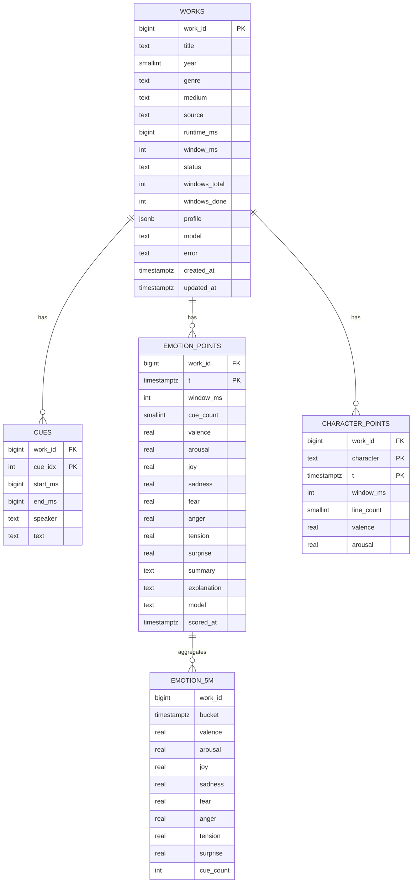

# Data model

Movie emotional arc — Tiger Data (TimescaleDB) schema reference.
The DDL in [`schema.sql`](./schema.sql) is the source of truth; this file is the quick reference.

## Entity diagram



Primary keys are composite where more than one column is marked PK (for example `emotion_points` is keyed on `work_id` + `t`). `emotion_5m` is a read-only continuous aggregate, not a table you write to.

## How film time is stored

Film position is stored as a `timestamptz` offset from the Unix epoch:

```
t = '1970-01-01 00:00:00+00'::timestamptz + (window_start_ms || ' milliseconds')::interval
```

So a window starting at 01:32:00 into the film is stored as `1970-01-01 01:32:00+00`.
This is what lets `time_bucket()`, continuous aggregates, and compression work without any custom code.
Convert back to seconds with `extract(epoch from t)`.

## Tables

### `works`

One row per film (or book / screenplay later). Plain table. Also carries job status so the UI can show scoring progress.

| Column | Type | Notes |
|---|---|---|
| `work_id` | bigint PK | identity |
| `title` | text | |
| `year` | smallint | nullable |
| `genre` | text | nullable; displayed and searchable in the film browser |
| `medium` | text | `film` (v1), `book`, `screenplay` |
| `source` | text | `srt`, `gutenberg`, `imsdb`, `upload` |
| `runtime_ms` | bigint | set after parsing; needed for %-of-runtime comparisons |
| `window_ms` | int | scoring window used; default 60000 |
| `status` | text | `queued` → `parsing` → `scoring` → `ready` (or `failed`) |
| `windows_total`, `windows_done` | int | progress counters |
| `model` | text | e.g. `gemini-2.5-flash` |
| `error` | text | last error message if failed |
| `created_at`, `updated_at` | timestamptz | |

### `cues`

Raw parsed subtitle lines. Never read by the chart. Used by the hover/explain endpoint and for re-scoring without the original file.

| Column | Type | Notes |
|---|---|---|
| `work_id` | bigint PK, FK → works | cascade delete |
| `cue_idx` | int PK | order within the file |
| `start_ms`, `end_ms` | bigint | |
| `speaker` | text | nullable; from screenplay or `NAME:` prefix |
| `text` | text | dialogue |

Index: `(work_id, start_ms)`.

### `emotion_points` — hypertable

The time series the chart reads. One row per `(work_id, window)`.

| Column | Type | Range | Notes |
|---|---|---|---|
| `work_id` | bigint PK, FK → works | | cascade delete |
| `t` | timestamptz PK | | epoch + window start |
| `window_ms` | int | | |
| `cue_count` | smallint | ≥ 0 | 0 = silent window → scores are `NULL`, chart shows a gap |
| `valence` | real | −1 … 1 | negative → positive |
| `arousal` | real | 0 … 1 | calm → intense |
| `joy` `sadness` `fear` `anger` `tension` `surprise` | real | 0 … 1 | |
| `summary` | text | | one sentence from Gemini at scoring time |
| `explanation` | text | | `NULL` until the user hovers; cached after |
| `model`, `scored_at` | | | provenance |

Hypertable on `t`, 1-day chunks. Compression after 7 days, segmented by `work_id`.

### `character_points` — hypertable (v2, empty in v1)

Same shape as `emotion_points` with an extra `character` key, for per-character arcs.

### `emotion_5m` — continuous aggregate (read-only)

5-minute `time_bucket` of `emotion_points`, averaged. Refreshed every minute by policy. Use for the default chart view; use raw `time_bucket()` for other resolutions.

## Website data contract

The film browser presents one row per `works` record with:

| Website field or behavior | Database source |
|---|---|
| Film title | `works.title` |
| Year | `works.year` |
| Genre search and label | `works.genre` |
| Runtime label and timeline scale | `works.runtime_ms` (convert to minutes in the API/UI) |
| Emotion distribution and dominant emotion | `works.profile->'avg'` |
| Emotion-over-time graph | `emotion_5m` columns `joy`, `sadness`, `fear`, `anger`, `tension`, and `surprise`, ordered by `bucket` |
| Film search | `works.title` and `works.genre` |
| Emotion sort | The corresponding value inside `works.profile->'avg'` |

`works.profile` is a cached JSON object with this shape:

```json
{
  "avg": {
    "joy": 0.32,
    "sadness": 0.18,
    "fear": 0.07,
    "anger": 0.05,
    "tension": 0.14,
    "surprise": 0.09
  },
  "peak": {
    "joy": 0.81,
    "sadness": 0.64,
    "fear": 0.42,
    "anger": 0.39,
    "tension": 0.76,
    "surprise": 0.58
  }
}
```

Each profile value is an independent model score from 0 to 1; emotion scores do not have to sum to 1. Compute `avg` over the non-NULL scored windows and `peak` as the maximum score per emotion. To reproduce the website's percentage distribution, divide each average by the sum of the six averages and multiply by 100. The highest average is the dominant emotion. Timeline values remain independent 0–1 scores and should not be normalized against one another. A chart time is `extract(epoch FROM bucket) / 60.0` minutes because film time is stored as an epoch offset.

The current website still uses local illustrative data and is not connected to a database or API. This contract describes the production data it should consume; the sample titles and scores in the page are not production records.

For an existing database created before `genre` was added, apply this one-time migration:

```sql
ALTER TABLE works ADD COLUMN IF NOT EXISTS genre TEXT;
```

## Query cookbook

Film-card records for the website:

```sql
SELECT work_id, title, year, genre, runtime_ms, profile
FROM works
WHERE medium = 'film' AND status = 'ready' AND profile IS NOT NULL
ORDER BY title;
```

Five-minute emotion timeline for one film (`$1` = work_id):

```sql
SELECT extract(epoch FROM bucket) / 60.0 AS minute,
       joy, sadness, fear, anger, tension, surprise
FROM emotion_5m
WHERE work_id = $1
ORDER BY bucket;
```

Arc at arbitrary resolution (`$1` = work_id, `$2` = bucket seconds):

```sql
SELECT extract(epoch FROM time_bucket(make_interval(secs => $2), t)) AS sec,
       avg(valence) AS valence, avg(arousal) AS arousal,
       avg(joy) AS joy, avg(sadness) AS sadness, avg(fear) AS fear,
       avg(anger) AS anger, avg(tension) AS tension, avg(surprise) AS surprise
FROM emotion_points
WHERE work_id = $1
GROUP BY 1
ORDER BY 1;
```

Normalized arc for comparing works (x = 0–49, % of runtime):

```sql
SELECT p.work_id,
       floor(extract(epoch FROM p.t) * 1000.0 / w.runtime_ms * 50) AS pct_bucket,
       avg(p.valence) AS valence
FROM emotion_points p
JOIN works w USING (work_id)
WHERE p.work_id = ANY($1)
GROUP BY p.work_id, 2
ORDER BY p.work_id, 2;
```

Dialogue behind a point (`$2` = window start ms, `$3` = window ms):

```sql
SELECT text
FROM cues
WHERE work_id = $1 AND start_ms >= $2 AND start_ms < $2 + $3
ORDER BY cue_idx;
```

Lowest three moments:

```sql
SELECT t, valence, summary
FROM emotion_points
WHERE work_id = $1 AND valence IS NOT NULL
ORDER BY valence ASC
LIMIT 3;
```

Insert a scored window (from the Gemini batch response):

```sql
INSERT INTO emotion_points
    (work_id, t, window_ms, cue_count, valence, arousal,
     joy, sadness, fear, anger, tension, surprise, summary, model)
VALUES
    ($1, '1970-01-01'::timestamptz + ($2 || ' milliseconds')::interval, $3, $4, $5, $6,
     $7, $8, $9, $10, $11, $12, $13, $14)
ON CONFLICT (work_id, t) DO UPDATE SET
    valence = EXCLUDED.valence, arousal = EXCLUDED.arousal,
    joy = EXCLUDED.joy, sadness = EXCLUDED.sadness, fear = EXCLUDED.fear,
    anger = EXCLUDED.anger, tension = EXCLUDED.tension, surprise = EXCLUDED.surprise,
    summary = EXCLUDED.summary, model = EXCLUDED.model, scored_at = now();
```

## Gemini scoring contract

Request: a batch of 8–10 windows `[{window_idx, start_sec, text}, …]` with `response_mime_type = "application/json"` and [`gemini_schema.json`](./gemini_schema.json) as `response_schema`.

Response: `{ "windows": [ { window_idx, valence, arousal, joy, sadness, fear, anger, tension, surprise, summary }, … ] }`.
Map each result back to its window by `window_idx` and upsert with the insert above.

## Setup

```bash
psql "$TIGER_DATABASE_URL" -f schema.sql
```
